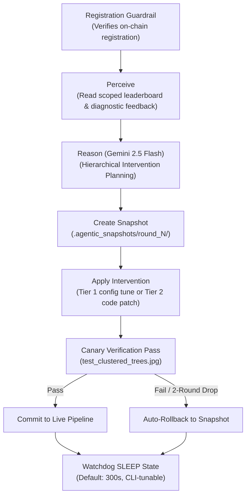

# Miner Documentation — Version 2.0.0 (Agentic Autonomous Subnet)

This guide details miner requirements, payload schemas, batch synchronization rules, high-precision polygon specifications, and the **AI Agent Autopilot Mode (`--agentic`)** introduced in **DataAnnotation Subnet v2.0.0 (CanopyMRV)**.

---

## 1. Subnet Overview & Dual Operational Modes

Miners in Subnet 498 detect, classify, and delineate ecological features (tree canopies, forestry crowns, biomass regions) on high-resolution aerial and satellite imagery.

### 1.1 Dual Operational Modes

1. **Standard Mode (Default):** Human-operated manual execution (`python neurons/miner.py ...`) behaves 100% identically to v1.5.0. Miners run inference using their chosen model checkpoint and fixed parameters.
2. **Agentic Autopilot Mode (`--agentic`):** Miner operates as a self-improving autonomous AI agent. After each round, the agent reads its scoped leaderboard standing and validator diagnostic feedback, reasons hierarchically with **Gemini 2.5 Flash**, tunes inference parameters or applies scoped code patches, validates improvements on a local canary image, and sleeps via a cost-guard watchdog between rounds.

---

## 2. AI Agent Autopilot Mode (`--agentic`)

When started with `--agentic`, the miner launches an autonomous background daemon executing a continuous **Perceive $\to$ Reason $\to$ Act $\to$ Verify $\to$ Sleep** self-improvement cycle:



### 2.1 Perceive: Dual Transport Feedback Ingestion
The miner agent ingests its scoped diagnostic receipt through two redundant transports:
- **Primary Transport (Cloudflare R2):** Fetches `s3://<R2_BUCKET>/<TELEMETRY_PREFIX>/feedback/<hotkey_sha256>/latest.json`.
- **Secondary Transport (Synapse Piggybacking):** Automatically extracts `synapse.last_round_feedback_json` dispatched by validators on the next round's `AnnotationTask`.

If the receipt's `round_num` has already been processed, the agent sleeps immediately, consuming **0 LLM tokens**.

### 2.2 Reason: Hierarchical Intervention Planning
The agent chooses exactly one atomic intervention per round from a strict hierarchy:
- **Tier 1 (Hyperparameter Tuning):** Adjusts `conf_thres` (0.15–0.70), `iou_thres` (0.30–0.70), `imgsz` (512–1024), `epsilon_factor` (0.003–0.020 for contour approximation density), or `max_area_ratio` (0.50–0.80) in `template/miner/agentic_params.json`.
- **Tier 2 (Scoped Code Patches):** **Mandatory Escalation Rule**: If `self_fidelity_score < 0.25` or `score_delta < 0.01` following a Tier 1 edit, the miner agent escalates to Tier 2 on the next round. Code patches are strictly restricted to allowlisted files:
  - `template/miner/detector_annotate.py`: Enables Slicing Aided Hyper Inference (SAHI) $2 \times 2$ overlapping sliding-window tile inference (15% overlap) + bounding box and polygon NMS merge to capture small/clustered tree crowns.
  - `template/miner/geometry.py`: Refines mask-to-polygon contour extraction and morphological watershed crown splitting.
- **Tier 3 (Hugging Face Checkpoint Upgrade):** Autonomously pulls specialized canopy checkpoints from the Hugging Face Hub if local GPU VRAM and disk bounds permit.

### 2.3 Strict Allowlist & Blocklist Boundaries
To guarantee safety and prevent sandbox violations:
- **Allowlisted Files:** `template/miner/detector_annotate.py`, `template/miner/geometry.py`, `template/miner/ecological_reasoning.py`, `template/miner/autoresearch.py`, `template/miner/backends/*`, `template/miner/agentic_params.json`, `autoresearch_config.yaml`.
- **Blocklisted Paths (Never touched by agent):** `neurons/validator.py`, `template/validator/*`, `template/hazard/*`, `template/protocol.py`, `.bittensor/wallets/*`, `.git/*`.

### 2.4 Canary Verification & Automatic Rollback Guard
Before committing any intervention:
1. Syntax is validated with `py_compile`.
2. A fast canary inference pass is executed against `test_clustered_trees.jpg`, verifying:
   - Output cleanly conforms to `AnnotationsFilePayload` (`annotations.v1`).
   - Total annotations $\le 512$.
   - Max bounding box area ratio $< 0.60$.
   - Quadratic vertex complexity $\sum (\text{vertices})^2 \le 2,000,000$.
   - Inference latency $< 15\text{s}$ (batch latency projection $< 450\text{s}$).
3. **Automatic Rollback:** If the canary fails, or if `self_fidelity_score` degrades for 2 consecutive rounds, the agent automatically restores the pipeline from `.agentic_snapshots/round_<N>/`.

### 2.5 Hard Human-in-the-Loop Registration Guardrail
The miner agent is strictly forbidden from executing wallet operations, coldkey commands, or registration/deregistration (`btcli subnet register` / `burned_register`). If its hotkey is unregistered on `--netuid`, the agent logs `[AGENTIC GUARDRAIL]` and enters standby sleep.

### 2.6 Cost-Control Watchdog & Circuit Breaker
- In audit and production modes, daily API token consumption is tracked in `.agentic_state/budget_ledger.json`.
- Uses **Gemini 2.5 Flash** (`thinking_budget=0`) with max completion cap (1,024 tokens for miner).
- Enforces daily budget limit (`--agentic.max_daily_calls 48`). If reached, the circuit breaker trips and gracefully degrades to heuristic mode.

---

## 3. Protocol & Task Lifecycle

### Task Synapse (`AnnotationTask`)
Validators query miners with an `AnnotationTask` containing:
- `task_id` (str): Unique UUID for this evaluation round.
- `batch_id` (str): Identifier of the active dataset batch (e.g. `"batch_1"`).
- `round_num` (int): Monotonically increasing round number.
- `annotation_images` (list): Up to 30 images with opaque `image_id` and download `image_url`.
- `last_round_feedback_json` (str, optional): Serialized scoped feedback receipt from the previous round.
- `annotations_uri` (str): Populated by miner with Cloudflare R2 URI (e.g. `s3://subnet/miner_artifacts/...`).

### Strict Batch Synchronization
- Annotations uploaded to R2 **must** correspond only to the images received in the active batch.
- Submitting annotations from a mismatched batch triggers immediate rejection with 0.0 score.

---

## 4. High-Precision Polygon Specification

Validators adjudicate miner submissions with visual fidelity, crown completeness, and boundary precision scoring.

### Polygon Data Format
Each annotation item in `annotations` must include a high-precision polygon:
```json
{
  "hazard_class": "individual_tree",
  "confidence": 0.94,
  "bounding_box": [1667.22, 1739.97, 1889.21, 1968.41],
  "polygon": [
    [1724.8, 1740.8],
    [1721.6, 1744.0],
    [1718.4, 1744.0],
    [1692.0, 1756.2],
    [1675.4, 1780.0],
    [1667.2, 1820.5],
    [1678.1, 1890.3],
    [1740.2, 1955.0],
    [1820.0, 1968.4],
    [1889.2, 1930.1],
    [1875.0, 1820.0],
    [1820.5, 1750.2]
  ],
  "area": 38450.0,
  "weight": 0.009167
}
```

### Quality Guidelines:
1. **Contour Detail**: Polygons should contain sufficient vertices (12 to 64 points) to trace natural crown boundaries.
2. **No Man-Made Structures**: Exclude roads, roofs, bare soil, and water.
3. **Recall & Precision**: Detect both isolated crowns and canopy clusters; avoid crude 4-point boxes.

---

## 5. Running a Miner

### 5.1 Standard Human-Operated Mode (v1.5.0 Compatible)
```bash
python neurons/miner.py \
    --netuid <NETUID> \
    --subtensor.network <NETWORK> \
    --wallet.name <WALLET> \
    --wallet.hotkey <HOTKEY> \
    --axon.port <PORT> \
    --miner.model_backend yolo \
    --logging.debug
```

### 5.2 AI Agent Autopilot Mode (`--agentic`)
```bash
python neurons/miner.py \
    --netuid <NETUID> \
    --subtensor.network <NETWORK> \
    --wallet.name <WALLET> \
    --wallet.hotkey <HOTKEY> \
    --axon.port <PORT> \
    --agentic \
    --agentic.api_key <YOUR_GEMINI_API_KEY> \
    --agentic.model gemini-2.5-flash \
    --agentic.sleep_seconds 300 \
    --agentic.max_daily_calls 48 \
    --agentic.allow_code_edits \
    --logging.debug
```

### 5.3 Environment Variables (`.env`)
```ini
# Gemini API Key (Required for --agentic mode)
GEMINI_API_KEY=your_gemini_api_key_here
AGENTIC_LLM_MODEL=gemini-2.5-flash
AGENTIC_SLEEP_SECONDS=300
AGENTIC_MAX_DAILY_CALLS=48

# Cloudflare R2 Credentials
R2_ACCOUNT_ID=your_account_id
R2_ACCESS_KEY_ID=your_access_key
R2_SECRET_ACCESS_KEY=your_secret_key
R2_BUCKET_NAME=subnet
```

---

## 6. Self-Healing Operator CLI (`scripts/miner_agent_cli.py`)

Operators can monitor and tune the miner agent live:

```bash
# Check agent status, current parameters, and ledger usage
python scripts/miner_agent_cli.py status

# Manually advance one agentic perceive-reason-act step
python scripts/miner_agent_cli.py step

# View full intervention history and canary stats
python scripts/miner_agent_cli.py history

# Manually roll back allowlisted files to a previous snapshot
python scripts/miner_agent_cli.py rollback round_2

# Dynamically adjust sleep duration without restarting process
python scripts/miner_agent_cli.py set-sleep 120
```
