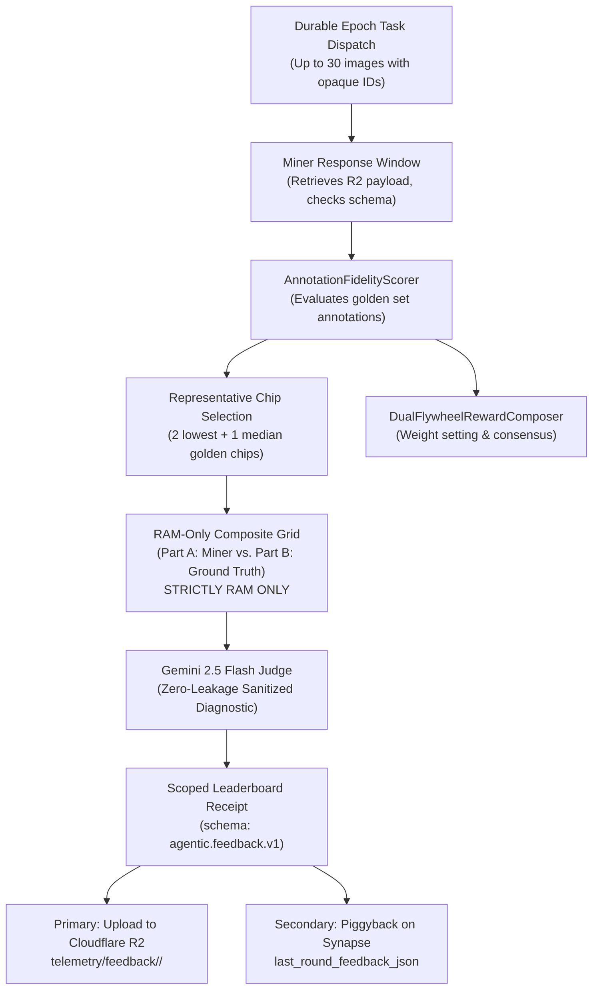

# Validator Documentation — Version 2.0.0 (Agentic Multimodal Diagnostic Engine)

This guide details validator operations, task coordination, the private golden set evaluation boundary, and the **Multimodal Diagnostic Engine & Scoped Receipt Subsystem** introduced in **DataAnnotation Subnet v2.0.0 (CanopyMRV)**.

---

## 1. Subnet Architecture & Validator Role

The validator coordinates annotation rounds, keeps the labeled golden ground-truth strictly private on local storage, scores miner fidelity, curates useful public-image contributions for export, and generates **multimodal engineering feedback** for active miners.



---

## 2. Multimodal Diagnostic Engine (`template/validator/agentic_feedback.py`)

At the conclusion of each round, right after `AnnotationFidelityScorer` evaluates miners against the Golden Set, the validator autonomously generates localized visual diagnostics for each active miner.

### 2.1 Strict Golden Ground-Truth Isolation
- **Zero Disk / R2 Golden Leakage:** Golden sample chips and ground-truth polygons reside strictly on the validator's local storage and are never exposed to miners.
- **RAM-Only Stitched Comparison Grid:** For each miner UID, the validator selects up to 3 representative chips (the 2 lowest-scoring golden chips + 1 median-scoring golden chip).
- The chips are stitched vertically in memory (`io.BytesIO`) into a $768 \times (384 \cdot k)$ px composite JPEG (quality 80):
  - **Left Panel (Part A):** Miner Prediction (satellite chip + miner predicted polygons in cyan/red + vertex dots + class/confidence text).
  - **Right Panel (Part B):** Golden Ground Truth (satellite chip + golden contours in green + missed in yellow `MISS` + false positives in red).

### 2.2 Multimodal LLM Judge (Gemini 2.5 Flash)
- Passes the single stitched composite JPEG together with quantitative polygon geometry statistics (`false_negative_rate`, `box_like_polygon_ratio`, `mean_vertices_per_polygon`, `mean_iou`) to **Gemini 2.5 Flash**.
- Uses `thinking_budget=0` and `max_output_tokens=120` to guarantee extreme cost efficiency and enforce 1–2 sentence engineering feedback.

### 2.3 Zero-Leakage Sanitization
Before leaving local validator memory, the diagnostic string passes through `sanitize_feedback()`:
- Strips all golden image IDs, chip hashes, filenames, and coordinate tuples (`[x, y]` / `(x, y)`).
- Enforces a hard ceiling of $\le 2$ concise sentences and $\le 45$ words.
- Focuses strictly on actionable engineering patterns (e.g. *"Missing 68% of small clustered tree crowns; lower detection confidence threshold and enable multi-scale tiling to improve recall"*).

---

## 3. Scoped Leaderboard Receipts (`agentic.feedback.v1`)

To prevent cross-miner spying while providing rich self-evaluation, the validator issues scoped receipts containing only that miner's standing:

### 3.1 Receipt Schema
```json
{
  "schema_version": "agentic.feedback.v1",
  "round_num": 1,
  "batch_id": "batch_1",
  "timestamp": "2026-11-09T02:16:15Z",
  "miner_uid": 1,
  "hotkey_ss58": "5E7Pvs6aVfq68vAr6wxAs33JMiNY1yGNdBFykL6cZtooq6W2",
  "leaderboard": {
    "self_rank": 1,
    "total_active_miners": 1,
    "percentile": 100.0,
    "self_fidelity_score": 0.0198,
    "prev_round_score": 0.0,
    "score_delta": 0.0198,
    "leader_score_gap": 0.0
  },
  "geometry_summary": {
    "mean_iou": 0.1416,
    "false_negative_rate": 0.584,
    "false_positive_rate": 0.412,
    "mean_vertices": 28.4
  },
  "validator_feedback_oneliner": "The miner exhibits a high false negative rate on small clustered crowns; refine contour approximation and adjust NMS IoU threshold."
}
```

### 3.2 Dual Transport Delivery
1. **Primary Transport (Cloudflare R2):**
   - Uploaded to `s3://<R2_BUCKET>/<TELEMETRY_PREFIX>/feedback/<hotkey_sha256>/round_<N>.json` and `latest.json`.
   - Miner hotkeys are hashed with SHA-256 for namespace isolation.
2. **Secondary Transport (Synapse Piggybacking):**
   - Cached in validator memory and attached directly to `synapse.last_round_feedback_json` during the next round's `AnnotationTask` dispatch.

---

## 4. Running a Validator

### 4.1 Production Execution
```bash
python neurons/validator.py \
    --netuid <NETUID> \
    --subtensor.network <NETWORK> \
    --wallet.name <WALLET> \
    --wallet.hotkey <HOTKEY> \
    --axon.port <PORT> \
    --validator.agentic_feedback \
    --validator.agentic_api_key <YOUR_GEMINI_API_KEY> \
    --validator.agentic_sleep_seconds 300 \
    --validator.agentic_max_daily_calls 200 \
    --neuron.sample_size 12 \
    --neuron.flywheel_golden_dataset_id climate_mrv \
    --neuron.flywheel_golden_ratio 0.10 \
    --logging.debug
```

### 4.2 Environment Variables (`.env`)
```ini
# Gemini API Key (Required for Agentic Multimodal Diagnostics)
GEMINI_API_KEY=your_gemini_api_key_here
AGENTIC_LLM_MODEL=gemini-2.5-flash
AGENTIC_SLEEP_SECONDS=300
AGENTIC_MAX_DAILY_CALLS=200

# Cloudflare R2 Credentials
R2_ACCOUNT_ID=your_account_id
R2_ACCESS_KEY_ID=your_access_key
R2_SECRET_ACCESS_KEY=your_secret_key
R2_BUCKET_NAME=subnet
R2_LOCALNET_TELEMETRY_PREFIX=localnet_sim/telemetry/
```

---

## 5. Security & Isolation Invariants

1. **Golden Set Protection:** Ground-truth labels and images are never written to presigned URLs, public endpoints, or Cloudflare R2.
2. **No Secret Leakage:** All API keys and bucket credentials must remain local in `.env` and are never serialized into receipts or synapse payloads.
3. **Fail-Closed Diagnostics:** If Gemini is unreachable or rate-limited, the validator falls back gracefully without interrupting consensus or on-chain weight setting.
